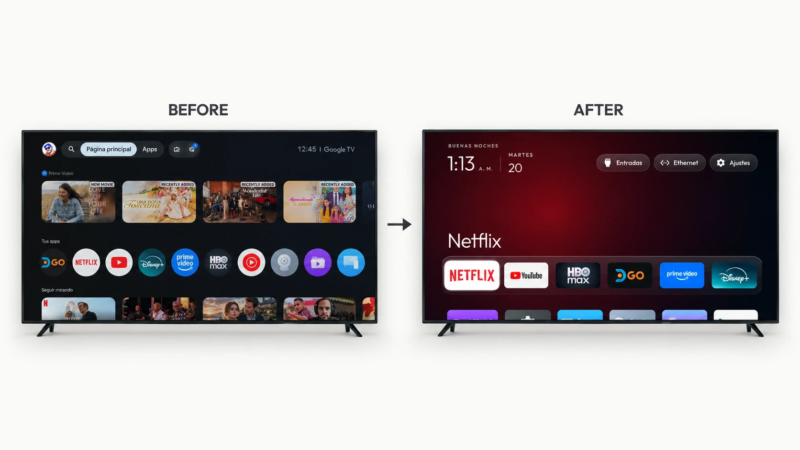
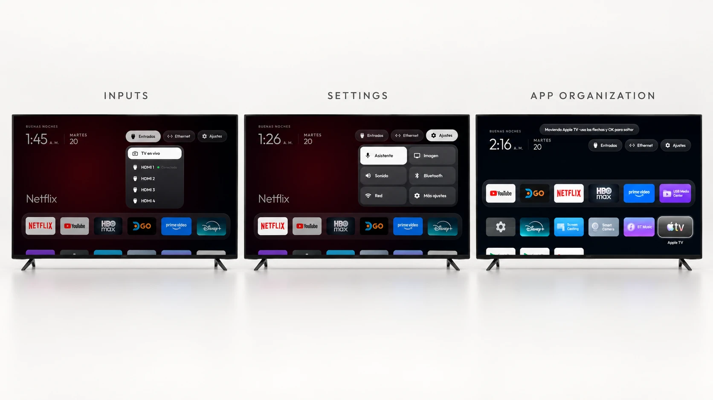
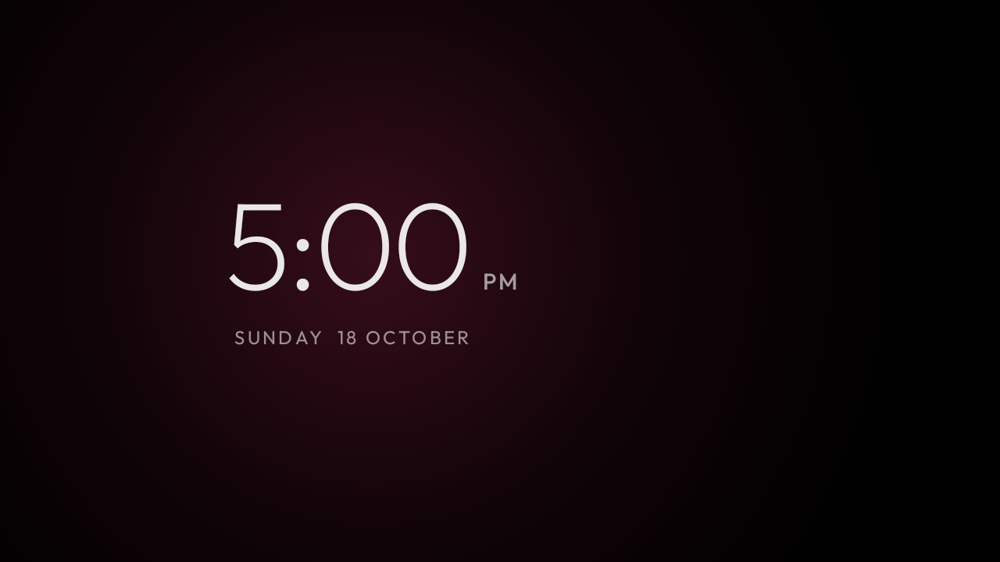
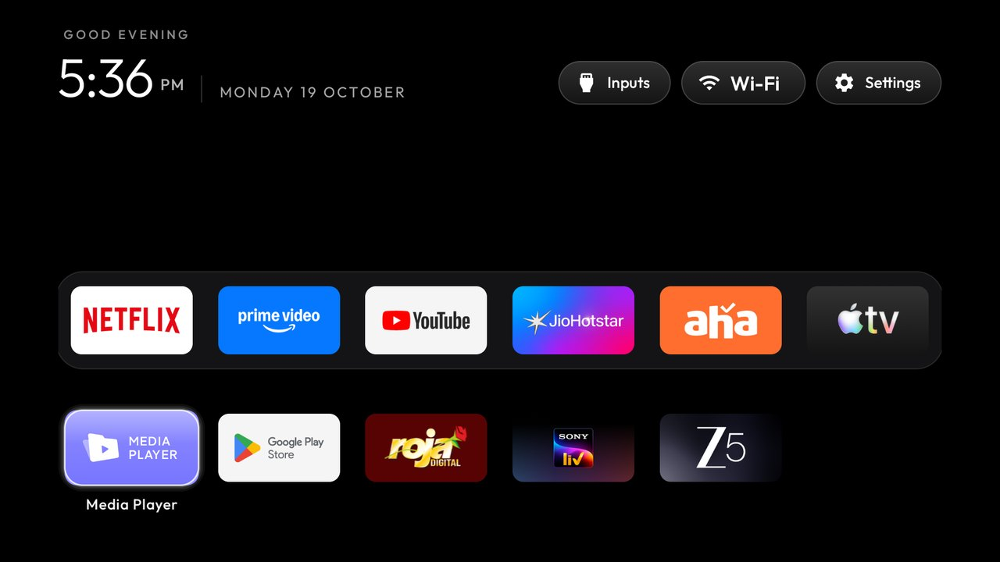

<p align="center"></p>

# Detox Your TV

**Less bloat. No ads. Just TV.**

Give your Android TV a fresh start. Remove ads, debloat your system, boost performance, and enjoy a
clean, Apple TV-inspired experience.

No root, no cables, nothing deleted: everything is switched off over Wi-Fi or Ethernet and comes
back with one command. Built and tested first on a **Hisense U75 with Google TV (Latin America)**,
with tested lists for 66 TV models from 25 brands.

Leer en español: [LEEME.md](LEEME.md).



## How it works

Android TVs have the same debug bridge (ADB) as Android phones. Switch on debugging in the TV's
developer options, allow your computer once, and the rest is standard Android tooling:

1. **Back up** the list of installed packages and settings.
2. **Disable** the manufacturer's telemetry, ad services, content rows and preloaded junk with
   `pm disable-user`. Nothing is uninstalled, so a restore script can undo every step.
3. **Install** a small native launcher and make it the default home screen.

The bloat differs by brand. Start from the list for your model in [`examples/`](examples/), or let a
coding assistant discover it with [`PROMPT.md`](PROMPT.md) and ask before touching anything you use.

## What you get

- **A pitch-black home** with a glass dock of your favourite apps, where Apple TV puts it.
- **A top shelf** naming the focused app in large type, with an ambient glow taken from its artwork.
- **The rest of your apps in a grid** that slides up when you press Down.
- **Reorder apps from the remote**: hold OK on an app, choose **Move**, carry it with the arrows
  (between dock and grid too) and drop it with OK. The order is saved.
- **A tvOS-style Control Center** on the Settings button: Assistant, Picture, Sound, Bluetooth,
  Network and All settings.
- **Inputs with Live TV first**, resuming the last broadcast channel (ISDB-T and Ginga included).
- **No sound lag** over HDMI ARC while you are on the home screen.
- **Safe mode**: if the launcher crashes three times in five minutes, it turns its animations off.
- **Themes** that change colours, wallpaper, dock and columns without a rebuild, and a Clock
  screensaver that drifts so nothing burns in.

And a TV that stops working against you: no sponsored rows, no analytics phoning home, no apps you
never asked for.



| | |
|---|---|
|  |  |
| *Clock screensaver* | *Six columns and a six-app dock, same launcher* |

## Supported TVs

Anything running **Android TV** or **Google TV**. Samsung (Tizen), LG (webOS), Roku and VIDAA run
different systems and cannot be used. **Fire TV** takes the debloat half only, since Fire OS will
not hand Home to a third-party launcher.

Which Hisense models are tested, which are likely to work, and how to check yours in thirty
seconds: [docs/COMPATIBILIDAD.md](docs/COMPATIBILIDAD.md). All 66 TV lists live in
[`examples/`](examples/README.md), one folder per model:

**TCL** 14 · **Xiaomi** 14 · **Sony** 9 · **Philips** 4 · **Hisense** 3 · **CHiQ** 2 · **Skyworth** 2 ·
AiPro2K · Amazon Fire TV · BenQ · Chromecast with Google TV · Hitachi · Insignia Fire TV ·
NVIDIA Shield · OnePlus · Panasonic · PRISM+ · RCA · Redmi · SANYO · Thomson · Toshiba Fire TV · Vu ·
Stellamore and XGIMI projectors

<details>
<summary><strong>The full list</strong></summary>

| TV | OS |
|---|---|
| AiPro2K (Expressluck, dongnae; Changhong AI PONT family) | Android TV 14 |
| Amazon Fire TV Stick 4K, 1st gen 2018 (AFTMM, mantis) | Fire OS 6.7.1.1 / Android 7.1 |
| BenQ E55-735 (Changhong AI PONT, DVB96BQ) | Google TV 14 |
| CHiQ AI PONT (Changhong GTVU65, dangni, MediaTek mt5867) | Google TV 14 |
| CHiQ AI PONT (DVB93CQ) | Android TV 11 |
| Chromecast with Google TV 4K (sabrina) | Google TV 14 |
| Hisense HiSmartTV A4 (xiaoyushan, MStar m7322), India | Android TV 9 |
| Hisense SmartTV 4K FFM (huangshan, MediaTek) | Android TV 10 |
| Hisense U75 (hengshan, MediaTek), Latin America | Google TV 12 |
| Hitachi 65QLEDSM20 (MTC, bangbae, MediaTek m7322), Australia | Android TV 11 |
| Insignia 55" F30 4K Fire TV (NS-55F301NA25, AFTDCT31, duckie) | Fire OS 7 / Android 9 |
| NVIDIA SHIELD TV Pro 2019 (P2897, mdarcy) | Android TV 11 |
| OnePlus TV (D00, Dubai) | Google TV 14 |
| Panasonic 4KTV-JUP (Jupiter_PA, MediaTek) | Android TV 11 |
| Philips 50PUS8517/12 (TP Vision, PH1M_EA_9970A, MediaTek MT5895), Europe | Android TV 11 |
| Philips 55PUS7503/12 (TP Vision TPM171E, PH7M_EU_5596, MediaTek MT5891), Europe | Android TV 8.0 |
| Philips R8G Google TV (MOKA, whitefield, Realtek RTD2851F), US | Google TV 14 |
| Philips Smart 4K TV (Skyworth, eleonas, MediaTek), India | Google TV 14 |
| PRISM+ Q65 Ultra 2026 QLED 4K AI Google TV (R10G, PRISMPLUS_FFM, MOKA, Realtek RTD2875 SoC, RTD6748 platform) | Google TV 14 |
| RCA AI PONT SA (Changhong, redwood, ISDB92RC; also sold as realme 40-inch) | Android 14 |
| Redmi TV (MiTV-ANTL0, starwars) | Android 5.1.1 (not Android TV) |
| SANYO ATV R2 (SCBC, Realtek RTD285O) | Android TV 9 |
| Skyworth SWTV-21AE (sunnyvale, MediaTek) | Android TV 14 |
| Skyworth SWTV-24NA-4K NF (eleonas, MediaTek mt5896), US | Google TV 14 |
| Sony BRAVIA 4K AE2 (BRAVIA_AE2, MediaTek MT5897), North America | Google TV 14 |
| Sony BRAVIA 4K GB (BRAVIA_ATV2_EU, BRAVIA_ATV2) | Android TV 9 |
| Sony BRAVIA 4K UR2 (BRAVIA_UR2_4K, MediaTek) | Android TV 10 |
| Sony BRAVIA 4K VH2 (KD-55X80J, BRAVIA_VH2, MediaTek), EU | Google TV 12 |
| Sony BRAVIA 9 II (K-65XR90M2, BRAVIA_AE3, MediaTek MT5838) | Google TV 14 |
| Sony BRAVIA BF1 (BRAVIA 2 II class, BRAVIA_BF1_4K_A, MediaTek) | Google TV 12 |
| Sony BRAVIA KD-55X85J (2021, BRAVIA_VH2, MediaTek MT5895), South America | Google TV 12 |
| Sony BRAVIA KD-65X80J (2021, BRAVIA_VH2, MediaTek), India | Google TV 10 |
| Sony BRAVIA XBR-65X900E (2017, BRAVIA_ATV2) | Android TV 9 |
| Stellamore T950S projector (Droidlogic be30a3, Amlogic txhd2) | Android 13 |
| TCL 40S5400A (C06, C06_2K_GB, MediaTek MT9221, 1 GB) | Android TV 11 |
| TCL 43C645 (Smart TV Pro, Realtek RTD2851 / R51MT05, V8-R51MT05-LF1V652) | Google TV launcher on Android TV 11 |
| TCL 50EP680 (Europe, BeyondTV, Realtek rtd285o) | Android TV 11 |
| TCL 55" 4K Google TV, 2023 (G10, G10_4K_US_NF); also TCL 55P6K, Spain (G10_4K_GB_NF_32BIT) | Google TV 12 |
| TCL 55Q10G Pro (China, tcl_mt5879_cn, MediaTek MT9952) | Android TV 11 |
| TCL 65C725 (Smart TV Pro, BeyondTV4) | Android TV 11 |
| TCL 65C735 (Smart TV Pro, G05, MediaTek), France | Google TV 11 |
| TCL ak30a5 (China, Amlogic) | Android TV 9 |
| TCL BeyondTV (India) | Android TV 9 |
| TCL BeyondTV, EU/Nordic (Realtek RTD2851, V8-R851T02-LF1V606) | Android TV 9 |
| TCL BeyondTV2 (Latin America / Brazil, Realtek RTD2851) | Android TV 9 |
| TCL QM6K Pro, 2025 (G08, MediaTek tcl9618) | Google TV 14 |
| TCL Smart TV Pro (G05, G05_4K_US, MediaTek MT5889) | Google TV 11 |
| TCL UnionTV, Latin America (TCL-built like Thomson 32HE5800, Realtek RT2841) | Android TV 9 |
| Thomson 32HE5800 (TCL-built UnionTV, Realtek RT2841), Spain | Android TV 9 |
| Toshiba Fire TV (AFTHA004, hazel) | Fire OS 7 / Android 9 |
| Vu 4K (HVCL, lushan, MediaTek), India | Google TV 12 |
| XGIMI Horizon S Pro projector (XK03H, xgimigalileo, MediaTek) | Android TV 11 |
| Xiaomi Mi Box S (MIBOX4, oneday), streaming box | Android TV 9 |
| Xiaomi Mi Box S 2nd gen (MiTV-AFKR0, jaws), streaming box | Google TV 11 |
| Xiaomi Mi TV (MiTV-MOOQ0, croods) | Android TV 10 |
| Xiaomi Mi TV 4A (MiTV-MOOQ1) | Android TV 10 |
| Xiaomi MiTV-AESP0 stick (aquaman, 1 GB) | Android TV 9 |
| Xiaomi MiTV-ASTP1 (maverick), China firmware 2.40.641.0514.cn, 1 GB RAM, 720p | Android TV 9 (CN build) |
| Xiaomi MiTV-AXFR1 (rango, Amlogic, 1 GB), India | Android TV 11 |
| Xiaomi MiTV-AXSO0 (dangal; Mi TV 4C Pro 2019 / 4A Pro) | Android TV 9 |
| Xiaomi MiTV-MOOR2 (venom, MediaTek) | Google TV 11 |
| Xiaomi MiTV-MOSR4 (irobot, MediaTek) | Google TV 11 |
| Xiaomi MiTV-MSSP3 (machuca, MediaTek) | Android TV 11 |
| Xiaomi MiTV-MSSP3 (machuca, MediaTek), Android 9 firmware PI.7524 | Android TV 9 |
| Xiaomi TV A Pro 75" 2026 (MiTV-MZTU0, river, MediaTek) | Google TV 14 |
| Xiaomi TV Box S 3rd gen (MiTV-AFMU0, twilight, Amlogic), streaming box | Google TV 14 |

</details>

## Quick start

You need a computer on the same network as the TV and Python 3. Building the launcher also needs
JDK 17 and Android SDK platform 34 (Android Studio ships both).

1. **On the TV:** Settings → System → About → press OK on **Build** seven times → back →
   Developer options → **USB debugging** on, and **Network/ADB debugging** if you see it.
2. **Note the TV's IP address** (Settings → Network). It goes where the commands say `<ip>`.
3. **On your computer**, inside this folder:

```bash
python3 -m venv tools/venv && tools/venv/bin/pip install -r tools/requirements.txt
export TV_HOST=<ip>

tools/venv/bin/python -I tools/tv.py --probe                 # model, Android version, firmware
tools/disable.sh examples/hisense-u75-hengshan/debloat.txt   # apply the list for your model
launcher/build-and-install.sh                                # build the launcher and make it Home
```

The first time, the TV asks you to allow the computer: accept it. When you are done, switch
debugging off again in Developer options.

On Windows every script has a PowerShell twin:

```powershell
python -m venv tools\venv; tools\venv\Scripts\python.exe -m pip install -r tools\requirements.txt
powershell -ExecutionPolicy Bypass -File tools\disable.ps1 -TvHost <ip> examples\hisense-u75-hengshan\debloat.txt
powershell -ExecutionPolicy Bypass -File launcher\build-and-install.ps1 -TvHost <ip>
```

The full Hisense U75 setup, including what was kept on purpose, is in
[profiles/hisense-sala/LEEME.md](profiles/hisense-sala/LEEME.md).

| Tool | What it does |
|---|---|
| [`tools/tv.py`](tools/tv.py) | Pure-Python ADB client: shell, batch, push, pull. Works where the stock `adb` binary is blocked. |
| [`tools/b64push.py`](tools/b64push.py) | Uploads large files such as APKs in base64 chunks and verifies the checksum. |
| [`tools/disable.sh`](tools/disable.sh), [`restore.sh`](tools/restore.sh) | Apply or undo a debloat list. |
| [`tools/theme.sh`](tools/theme.sh) | Push a folder from [`themes/`](themes/) to the launcher and restart Home. |
| [`launcher/build-and-install.sh`](launcher/build-and-install.sh) | Builds a shrunk release, installs it, switches Home, and rolls back if Home does not land on it. |

The install scripts ask the TV which launcher owns Home and only disable one they recognise
(`tvlauncher` or `launcherx`); pass `STOCK_LAUNCHER=<package>` (`-StockLauncher`) to override, or
`none` to leave it alone.

## The launcher

A small native Android TV app (`com.detoxyourtv.home`) in plain Java with AndroidX RecyclerView and
nothing heavier. Built for sets with 1 GB of RAM: no video, no network calls, no background services.

- **Configure** in [`config.xml`](launcher/app/src/main/res/values/config.xml): dock order, hidden apps, the Live TV package, columns, rows under the dock, and `reduced_motion` for TVs whose GPU cannot keep up.
- **On-TV settings:** hold OK on Settings and choose Launcher settings to set 4 to 7 apps per row, turn animations on or off, and opt into advanced effects.
- **Themes** set the same keys plus a background colour and a wallpaper from a `config.json` pushed to the TV. Four ship in [`themes/`](themes/).
- **Language** follows the TV, with Spanish dates and labels included.
- **Module cards** let other TV apps declare their own tile, only after you approve it: [`docs/modules.md`](docs/modules.md), contract in [`docs/specs/card.md`](docs/specs/card.md).
- **Clock screensaver:** pick "Clock" in the TV's screensaver settings, or over ADB:
  `tools/tv.py 'settings put secure screensaver_components com.detoxyourtv.home/.ClockDream; settings put secure screensaver_enabled 1'`

## Restoring your TV

Keep the list you applied. The restore script re-enables exactly those packages, puts the stock
launcher back as Home and resets the animation scales:

```bash
TV_HOST=<ip> tools/restore.sh examples/<your tv>/debloat.txt                                          # Android TV
TV_HOST=<ip> tools/restore.sh examples/<your tv>/debloat.txt com.google.android.apps.tv.launcherx     # Google TV
```

It leaves the new launcher installed; remove it with
`tools/tv.py 'pm uninstall com.detoxyourtv.home'` or from the TV's Settings → Apps. If the TV is
unreachable, its own Settings → Apps page can re-enable packages too.

## Before you start

- On Hisense and Vu, **never** disable `com.vt.tv.smartsense*`, `com.vt.tv.ai_sense` or
  `com.vt.tv.aiot*`: the TV boots into Android Recovery. If it happens, choose **Try again**, never
  Factory data reset.
- Disable in small batches and reboot after each one, so a bad package is easy to find.
- Network ADB is plaintext on port 5555. Switch debugging off when you are done.
- More things that can bite, and how to get out of them: [docs/TROUBLESHOOTING.md](docs/TROUBLESHOOTING.md).
- Helping someone in another home: [docs/REMOTE.md](docs/REMOTE.md).

This is not an official Hisense or Google product. Use it at your own risk.

## Contributing

The most useful contribution is your TV's debloat list, so the next person with that model does not
have to rediscover it. [CONTRIBUTING.md](CONTRIBUTING.md) has the format and the testing we ask for.

## Licence

MIT, see [`LICENSE`](LICENSE). The Outfit typeface is under the SIL Open Font License, see
`launcher/FONT-LICENSE-OFL.txt`.
